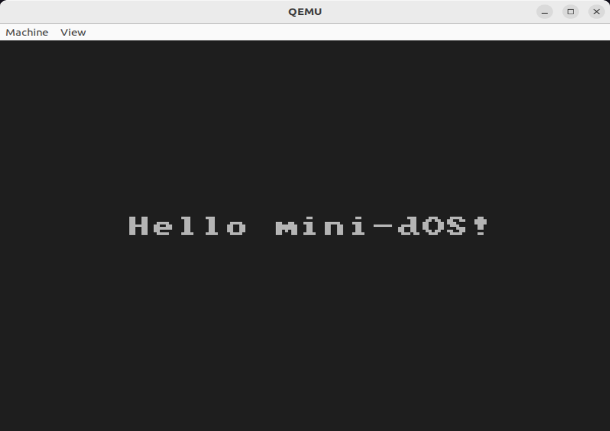

<h1>mini-dOS</h1>

<b>직접 만든 커널 위에서 DOOM을 돌린다</b>

---

## 팀원

<table>
<tr>
  <th align="center">이름</th>
  <th align="center">학번</th>
  <th align="center">GitHub</th>
  <th>담당</th>
</tr>
<tr>
  <td align="center" nowrap>김보겸 (팀장)</td>
  <td align="center">32210**7</td>
  <td align="center"><a href="https://github.com/bogamie">@bogamie</a></td>
  <td>부트로더 및 커널 진입(Multiboot2 → Long Mode) · GDT/TSS · IDT 및 인터럽트 서브시스템 · 페이징(PML4 · Higher-half · Direct-map) · VMM · vmalloc · libc shim 전반 · PIT 틱 카운터</td>
</tr>
<tr>
  <td align="center" nowrap>최승원</td>
  <td align="center">32214**2</td>
  <td align="center"><a href="https://github.com/SeungwonChoi-kr">@SeungwonChoi-kr</a></td>
  <td>Buddy 할당자 · Slab 할당자 · GOP 프레임버퍼 및 비트맵 폰트 · 콘솔 드라이버 · 미니 쉘 · PS/2 키보드(Ring Buffer · shift/caps_lock) · DOOM glue 레이어(DG_* 6종) · WAD 로딩</td>
</tr>
</table>

---

## 어떤 프로젝트인가요?

OS 교과서는 페이징, 인터럽트, 메모리 관리를 설명하지만 직접 구현해본 적은 없었습니다.

mini-dOS는 그 질문에서 시작했습니다 — **x86-64 베어메탈 위에 직접 올린 커널로 DOOM(1993)을 돌릴 수 있을까?**

단순한 Hello World 커널이 목표가 아니었습니다. GRUB으로 부팅해 Long Mode에 진입하고, 페이지 테이블을 직접 구축하고, Buddy · Slab · vmalloc 메모리 할당자를 올리고, 인터럽트 핸들러를 등록하고, 프레임버퍼에 픽셀을 그리고, PS/2 키보드 입력을 받아 — 그 위에서 DOOM의 플랫폼 콜백(`DG_DrawFrame`, `DG_GetKey`, `DG_GetTicksMs`, `DG_SleepMs` 등 6종)을 커널 서비스에 연결했습니다.

---

## 시연 영상

<table>
<tr>
<td valign="top" width="55%">

 

</td>
<td valign="top">

| 타임스탬프 | |
|---|---|
| `0:00` | `help` |
| `0:15` | `clear` |
| `0:22` | `echo` |
| `0:40` | `free` |
| `0:50` | `whoami` |
| `1:02` | `uptime` |
| `1:13` | `uname` |
| `1:34` | `poweroff` |
| `2:05` | `doom` |

</td>
</tr>
</table>

---

## 화면

| 미니 쉘 | DOOM |
|:---:|:---:|
|  |  |

**쉘 명령어**

| `free` | `uname` | `whoami` |
|:---:|:---:|:---:|
|  |  |  |

---

## 주요 구현

| | |
|:---:|---|
| **3단계 메모리 시스템** | 물리 메모리(Buddy PMM) · 커널 힙(Slab) · 범용 가상 메모리(vmalloc)를 계층으로 분리해 구현 |
| **Higher-half 커널** | 커널을 가상 주소 `0xFFFFFFFF80000000`에 배치, Direct-map(`0xFFFF888000000000`)으로 물리 메모리 전체 접근 |
| **DOOM glue 레이어** | `glue/` 경계를 통해 6개 콜백만으로 DOOM ↔ 커널을 연결 — DOOM 코드를 한 줄도 수정하지 않음 |
| **자체 libc shim** | POSIX 의존성 없이 DOOM 빌드에 필요한 stdio · stdlib · string을 커널 위에서 직접 구현 |
| **GOP 프레임버퍼** | UEFI GOP 기반 픽셀 렌더링 및 8×8 비트맵 폰트로 텍스트 콘솔 구현 |

---

## 기술 스택

